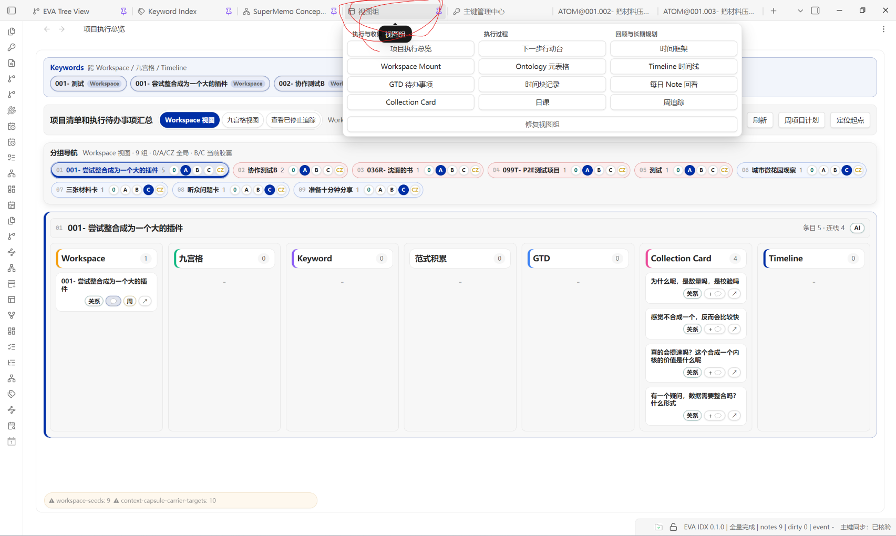
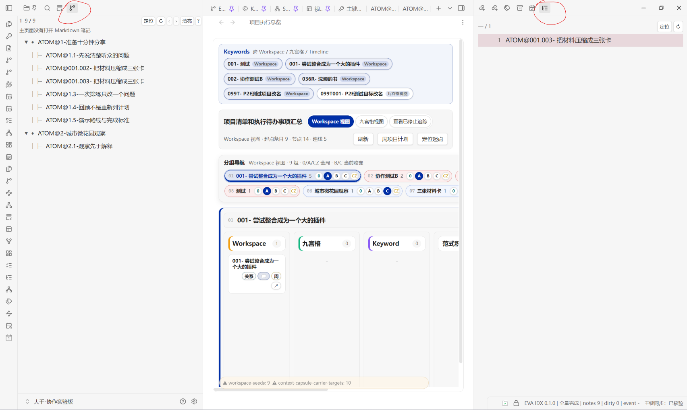

# 大千 · NEWERA 插件分享库

大千目前用于分享从 NEWERA 同步的插件。历史“一统内核”方案已经废弃；这不表示当前分享库或插件停止维护。

最新更新：[PEO 自治使用说明](ai-context/PEO_AUTONOMY.md)，减少普通内容编辑引发的全面核验，结构变化仍保留检查。

## 首次打开：先整理界面，再使用两侧导航

在 Obsidian 中打开本仓库的 `vault/` 文件夹后，先按下面两步确认界面。图片中的红圈标出了要点击的入口；截图里的笔记名称和条目数量仅作示例。

### 1. 先点顶部「视图组」Tab

先点击顶部的 **「视图组」** Tab，让界面规整，再开始浏览各功能视图。入口在下图红圈处。



[查看视图组原图](docs/images/view-group-entry.png)

### 2. 左边 EVA 分支树，右边 ATOM 侧栏导航

两侧边栏都提供笔记列表视图。展开左右边栏后，点击下图红圈中的对应图标：

- **左侧：EVA 分支树**，查看树状笔记列表。
- **右侧：ATOM 侧栏导航**，查看 ATOM 笔记列表。

确认后的布局是：**左侧 EVA 分支树 — 中间主工作区 — 右侧 ATOM 侧栏导航**。



[查看双侧边栏原图](docs/images/eva-atom-sidebars.png)

## 让你的 AI 理解这个系统

先让 AI 阅读 [资料包入口](ai-context/README.md) 和 [当前共享版本](ai-context/CURRENT_BASELINE.md)，再根据问题查 Atlas、Framework 与开发 Skill。资料包包含完整 Atlas/Framework 快照、开发 Skill 及全部 references、术语与协议入口、本次插件文件核对结果和未提供历史来源的明确标记。

仓库根目录的 AGENTS.md 提供 AI 入口约定；支持项目 Skill 的工具可发现 `.agents/skills/obsidian-system-plugin-dev/SKILL.md`，具体加载方式取决于所用 AI 工具。

文件完整性检查：`python verify_ai_context.py`。Atlas 查询可运行 `python ai-context/scripts/atlas_query.py "GTD"`，仅写本机查询结果，不修改笔记库。

完整 Obsidian 库位于 `vault/`，包括隐藏配置、插件及依赖、插件数据、笔记、附件。使用 Obsidian 打开 `vault/`，不是仓库根目录。

## 恢复和校验

需要 Python 3。建议禁用 Git 自动换行与过滤器后检出：

```powershell
git clone --no-checkout https://github.com/halcyonablid/invisible-myriad.git invisible-myriad
cd invisible-myriad
git config core.autocrlf false
git config core.longpaths true
python -c "from pathlib import Path; Path('.git/info/attributes').write_text('* -text -filter -ident -working-tree-encoding\n')"
git checkout main
python restore_vault.py verify
python restore_vault.py restore ../大千-恢复副本
```

恢复目录必须不存在；恢复工具验证全部文件 SHA-256，重建清单中的空目录。本仓库保存文件内容，不包含 NTFS 权限、时间戳及 Obsidian 应用安装程序。首次打开还原副本前，请检查同步类插件设置以免写入其他库。

本次为用户明确授权的公开整库备份。常见令牌、非空 JSON 凭据字段和敏感文件名扫描无命中；扫描不能保证发现所有类型的隐私信息。原库没有被修改。
