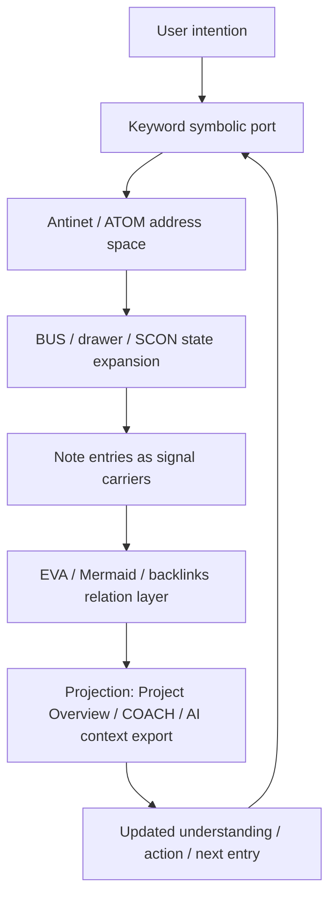

# Keyword As Symbolic Interface

status: draft_mvp
updated: 2026-07-14

## Observation

status: confirmed_by_user

The user's Obsidian system uses keywords as symbolic communication interfaces.

The user first finds a keyword, then descends from that keyword into the concrete tree position, note entries, BUS / drawer / subconcept structures, Mermaid address, and EVA relations. This is how the user communicates with the whole library.

## Core Claim

status: confirmed_by_user

Keywords are not normal tags. They are symbolic ports.

The note entries under them are signal carriers. The numbered Antinet / ATOM tree is the address space. BUS, drawers, subconcepts, Mermaid address semantics, and EVA relations are expansion mechanisms that turn a symbolic entrance into concrete evidence, memory, and action context.

## Layer Model

| Layer | Role | Example |
| --- | --- | --- |
| Symbolic port | User-facing keyword capsule | `Keyword / 关键词胶囊` |
| Address space | Antinet / ATOM numbered tree position | `ATOM@...` |
| State expansion | BUS, drawer, SCON, Mermaid `+` state transitions | `+BUS001`, `+SCON.电影` |
| Signal carrier | Concrete Markdown note entries | ordinary note, project note, material note |
| Relation layer | EVA relation, Mermaid graph edge, backlink | cross-view relation or graph connection |
| Projection layer | Project Overview, COACH, AI context export | read-only evidence packet or dashboard |

## Drawer-First Miniature Model

status: confirmed_by_user

中文术语：抽屉优先的世界微缩模型。

Not every promising symbol should immediately become a standalone keyword capsule.

When the user is building an unfamiliar large domain, a drawer can first operate as a visible miniature model of that domain. The drawer gives weak signals, intuitive materials, clippings, works, and early feelings a place to land before the user understands them well enough to promote a symbol into a capsule-level keyword.

This refines the layer model:

| Layer | Drawer-first interpretation |
| --- | --- |
| Capsule keyword | Mature concept-level symbolic port, suitable for cross-drawer recall |
| Drawer | Visible local model / container for a partially understood world region |
| BUS / note entries | Concrete growth path and signal carriers inside that region |

The user's practice is therefore not simply "make more keywords." In early world-model construction, the preferred operation is often:

```text
capsule-level frame
  -> drawer-level miniature model
  -> note-level signals
  -> later promotion into capsule keyword when mature
```

This matters for AI interpretation: a drawer may be intentionally underfilled yet semantically important because it gives the user a macro view of which world interfaces exist.

## Communication Pattern



## Full Network And Current-Attention Surface

status: confirmed_by_user

The symbolic interface needs both global completeness and local usability.

The full Keyword Index is where the user edits and admits new material into the whole symbolic network. Symbol Dialogue is not a second index. It is a local projection for symbolic ports that matter during the current period.

The user's refined practice is seed-based rather than exhaustive tagging:

```text
one strict-true note registration
  -> selected drawer as local seed
  -> structural ancestors for orientation
  -> complete selected subtree for depth
  -> shallow same-level peers for comparison
  -> unrelated branches omitted
```

This is more useful than a strict per-note filter because the neighboring structure supplies the context needed for dialogue and targeted enrichment. It also avoids forcing the user to add `符号对话: true` across every note in an already coherent local region.

Bayesian update: `refines` the prior symbolic-port claim. A symbolic port is not only an address into the whole library; it may also expose a bounded neighborhood whose breadth is intentionally controlled by attention.

## Why This Matters

status: inferred

This explains why specialized terms must not drift. If a keyword is paraphrased loosely, the agent may connect to the wrong symbolic port. That is not just a naming error; it changes the address path and can send the reading process into the wrong branch of the user's library.

It also explains why a keyword-first workflow is not the same as search. Search finds text matches. A keyword symbolic interface finds a system entrance and then follows the intended topology.

## Relationship To Framework And Skill

status: inferred

The framework / Atlas / Skill stack has a parallel shape:

- framework and Atlas files are durable structure;
- Skill is the runtime activation signal;
- the agent reads the structure through the Skill and then acts.

The user's Obsidian keyword system has the same pattern:

- keyword symbols are durable entrance structure;
- notes are signal and evidence carriers;
- the user's practice activates the symbol and descends into the address space.

This makes the keyword system a user-facing equivalent of the agent-facing framework entry mechanism.

## Agent Reading Rule

status: confirmed_by_user

When a task involves a keyword, do not treat it as a loose tag first.

Read it as:

1. a symbolic entrance;
2. a pointer to numbered tree position;
3. a doorway into BUS / drawer / SCON state;
4. a route toward note signals and relations.

Only use broad text search after the symbolic entrance and its local topology are understood or when the keyword path is missing.

## Boundaries

status: inferred

- Keyword symbolic interface is a knowledge model, not a request to change plugin ownership.
- Keyword Index remains owner of keyword records and UI behavior.
- Atlas records the model; framework records when agents should use it.
- Project Overview and COACH may project keyword evidence, but they do not become owners of keyword data.
- Drawer-first world miniature modeling is a user practice / symbolic-organization model. It does not require changing Keyword Index schema by itself.

## Open Questions

status: unknown

- How should AI context export represent keyword symbolic ports without flattening them into labels?
- How should COACH choose the traversal budget after entering a keyword branch?
- Should keyword symbolic interface become a first-class field in future evidence packets?
- When should an underfilled drawer be promoted into a capsule keyword versus left as a miniature-model container?
