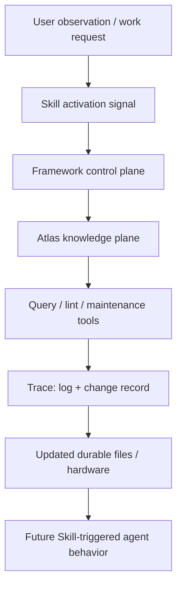

# LLM Wiki Operating Model

status: draft_mvp
updated: 2026-06-25

## Core Claim

status: confirmed_by_user

The Obsidian plugin-system Atlas is an LLM Wiki operating model: durable markdown files act as cognitive hardware, while skills act as activation signals that tell an agent when and how to read, update, lint, and query that hardware.

This is not only documentation for humans. It is a persistent structure that changes future agent behavior.

## Components

| Component | Role | Example |
| --- | --- | --- |
| Durable files / hardware | Stable knowledge and control structure that survives sessions | `atlas/`, `framework/`, change records, cards |
| Skill activation / signal | Runtime trigger that tells the agent what to read and how to act | `obsidian-system-plugin-dev` |
| Framework control plane | Entry, registry, question map, update protocol, boundary rules | `framework/entry-index.md`, `update-protocol.md` |
| Atlas knowledge plane | Concepts, claims, workflows, terminology, contracts, system model | `atlas/index.md`, `glossary.md`, knowledge chapters |
| Maintenance protocol | Converts observation into claim, status, update target, trace | `framework/update-protocol.md` |
| Query/lint tooling | Keeps the wiki retrievable and lower-entropy | P0/P1/P2/P3 Atlas scripts |
| Trace layer | Explains what changed and why | `atlas/log.md`, `change-records/` |

## Operating Loop

## Why It Matters

status: inferred

Without the durable wiki layer, each agent must reconstruct the user's system from scattered notes, JSON, code, and conversation fragments. That causes terminology drift, repeated scanning, and wrong ownership assumptions.

With the LLM Wiki operating model:

- stable concepts live in Atlas;
- execution and update rules live in framework;
- trigger behavior lives in Skill;
- changes leave trace;
- query and lint tools reduce entropy;
- new user observations update the prior rather than becoming isolated notes.

## Boundary With Ordinary Notes

status: inferred

An LLM Wiki page is not just a note. It is part of a maintained reading and update system.

It should have:

- a stable path;
- a clear status;
- a known owner plane: Atlas, framework, card, or change-record;
- links from index/registry when durable;
- source status or trace;
- a future use case for agent behavior.

If a note has no role in future reading, query, maintenance, or agent action, it is not yet part of the LLM Wiki operating model.

## Boundary With Framework

status: confirmed_by_user

Atlas records the LLM Wiki operating model as knowledge.

Framework records how agents enter, update, and guard the wiki.

Skill activates the model at runtime.

Do not move all LLM Wiki explanation into framework. Framework should remain small and hard: it points to this model and enforces the control rules.

## Current Implementation In This Repository

status: confirmed_by_memory

- Atlas has `purpose.md`, `schema.md`, `index.md`, `log.md`, `glossary.md`, and `aliases.md`.
- Framework has `purpose.md`, `schema.md`, `index.md`, `entry-index.md`, `registry.md`, `question-map.md`, `update-protocol.md`, and `maintenance-log.md`.
- P0/P1/P2/P3 maintenance scripts check index integrity, terminology drift, source trace, stale claims, update protocol, index drafts, question-map sync, lint aggregation, and Atlas-first query.
- `obsidian-system-plugin-dev` triggers framework entry, Atlas terminology reading, and maintenance/query commands.

## Agent Rule

status: inferred

When asked to "用框架落一下" or to preserve a reusable system idea:

1. identify whether the idea is knowledge-plane or control-plane;
2. place stable concepts in Atlas;
3. place entry/update/guard rules in framework;
4. record engineering changes in change-records;
5. update index/registry/question-map/log only as needed;
6. use P3 query afterward to confirm retrievability.

## Open Questions

status: unknown

- Should `atlas_query.py` improve framework registry/question-map recall for newly registered knowledge models?
- Should future maintenance scripts detect durable pages that lack a source-status section?
- Should Skill include a direct pointer to this page, or is Atlas index enough?
