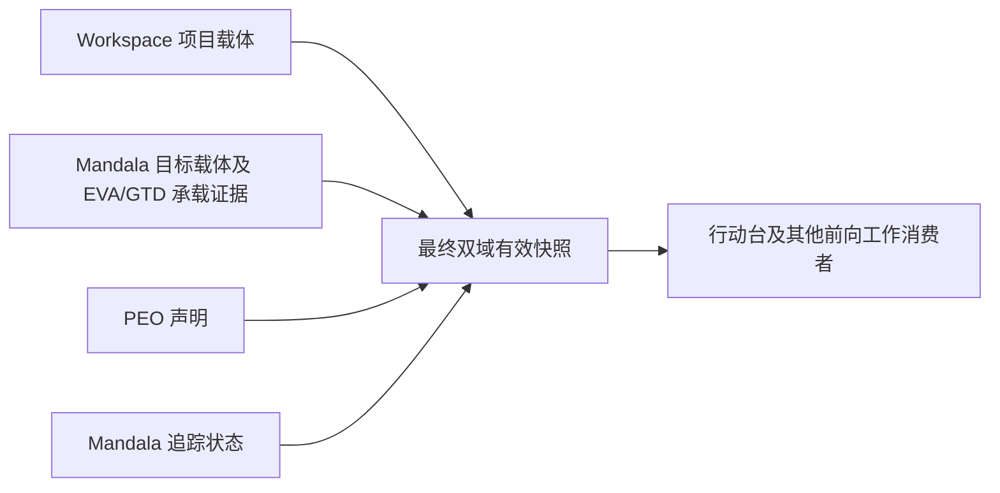

# 从有效操作上下文主键到下一步行动

## 2026-10-24 自动更新链的验收口径

source_status: confirmed_by_code（仓库候选/合成宿主）；update_type: refines。

创建或恢复依次区分三个结果：owner回执确认保存、后台投影已发布、原插件页面出现同一对象及内容。前一步成功不代表后一步完成；刷新失败不能当创建失败而盲目重复创建。历史内容和绑定继续保留在原owner，停止追踪隐藏普通选项，回看按需定位原历史条目。

r21已在实际owner方法与四消费者适配器的合成链中证明：即使图导航遗漏，当前配置来源的有效项目/目标经final display补充进入普通目录。该证据用了强制index/refresh，因此不证明创建完成后页面会自动更新。普通目录并集与最终有效资格的区别见[PEO候选边界](../plugins/project-execution-overview.md)；资格公式仍以[canonical定义](../knowledge/effective-operational-context-key.md)为准。

自动链验收应沿原创建/恢复入口观察既有通知→owner索引/失效→后台发布→正常页面；分别记录保存与可交互终点、失败及后台成本。模拟适配器渲染、原生DOM定位和重启持久性分别报告。未知状态不恢复编辑、不丢草稿；回看不恢复追踪。证据：[r21](../../../../REFERENCE_BOUNDARIES.md#ref-299)（外部来源未随包提供）。未实施新持续日志或全库扫描，实时排期只由[活动PLAN](../../../../REFERENCE_BOUNDARIES.md#ref-300)（外部来源未随包提供）维护。

status: active
updated: 2026-10-02
source_status: confirmed_by_user + confirmed_by_memory; code observations marked below

本页连接业务协作与性能评估入口。用户要求系统整体响应、后台成本和后续扩展性成为开发依据，并明确未来新插件从设计时考虑测试点。本文不表示已批量插桩，也不证明近期优化导致行动台变慢。

## 所有权与入口

资格细则以 [有效操作上下文主键](../knowledge/effective-operational-context-key.md) 为单一事实源；[操作上下文主键](../knowledge/context-capsule-key.md) 说明身份。这里不另造一套资格公式。

| 插件 | 当前职责 | 不能据此推断 |
| --- | --- | --- |
| Workspace Mount | 项目域的当前项目条目载体、稳定身份与 owner 内容 | 一个项目条目自动满足所有有效资格 |
| PEO / Project Overview | 操作上下文声明、旧 Kill 历史诊断、停追历史只读回看、跨源证据投影 | 拥有所有来源内容，或必须先打开页面才有资格 |
| Mandala | 目标节点、项目/目标追踪状态；最终双域有效快照聚合 | 仅有目标节点或有追踪就一定有效 |
| EVA 与 GTD | 目标域所需关系及 GTD 顶层项目载体证据，各自 owner 维护 | 同名项目、普通边或反向边可替代精确承载证据 |
| Collection Card | 卡片内容、稳定节点和 owner 创建/确认流程 | 消费者可直接改写其私有 JSON |
| 下一步行动台 | 本地 membership、显示/执行状态、草稿，消费资格与来源投影 | 本地旧列表可重新授予当前写入资格 |

参考：[PEO](../plugins/project-execution-overview.md)、[Collection Card](../plugins/collection-card-view.md)、[API registry](../api-registry.md)、[跨插件 Map/Reduce 边界](../knowledge/cross-plugin-aggregation-mapreduce-pipeline.md)。Timeline 的历史安排是历史证据，不是当前资格凭证。

## 工作流 A：新增并使用有效主键

项目域从 Workspace 项目载体开始，目标域从 Mandala 稳定节点及符合 canonical 的 EVA/GTD 承载证据开始。两域都还涉及 PEO 声明和 Mandala 追踪（停止/恢复追踪是唯一主动生命周期开关；旧 Kill 只作历史诊断）。条件满足后由最终有效快照供消费者使用。

这不是一个全系统原子创建事务；下面是依赖关系，不要求用户严格按固定点击顺序操作：

图中的域证据分别进入对应域，不表示项目必须具备目标域承载。上游不可用、条件尚未齐备、明确失效要分开表达；不能为了减少等待让消费者建立第二个资格 owner，也不能清空历史记录。

## 工作流 B：创建一条下一步待办

1. 用户选定 membership，输入草稿。
2. 经 owner API 确认精确写入目标。
3. Collection Card 接收具有幂等身份的创建请求，返回可确认的结果。
4. 通知/投影更新使行动台读到新节点，显示并允许继续操作。

提交确认与投影可见是两个时刻。写入已确认而来源刷新失败，应保留已写入结果并说明待刷新；不能重新创建同一事项来重试读取。结果未知时核对 owner 回执/幂等状态，草稿继续受原有保护。

### 2026-10-01 现场观察与待证问题

- `confirmed_by_user`：弹窗先长时间等待，随后显示已写入 Collection Card、正在刷新，最后通知一个主键来源暂不可用且保留旧链接。
- `confirmed_by_code`：当日只读检查 actual runtime `next-action-workbench/main.js` 的 `CreateActionModal.commit` 与 `refreshImportedMemberships`，来源等待上限为 8 秒，提交后最多三次刷新尝试；PEO `getPrimaryCollectionCardSnapshot` 调用 `getPrimaryCollectionProjectionModel` 构建相应域总览，具有同域 in-flight 合并。
- `unknown`：宿主各阶段实际耗时、超时后仍运行的任务数、事件扇出、背景竞争以及最近改动的因果。静态代码只说明可能等待的位置，不证明它们实际占用多少时间。本轮不修改该运行链路。

## 性能采集设计与反馈入口

以下是后续接入方案，不是已有通用 trace API：沿动作入口、资格快照、目标确认、owner 提交、通知、投影重建、最新结果可交互和后台观察窗口设置有界观测点。新增有效主键的多个用户动作可以分别成 trace，以相关链接连接，不伪装成一个原子写事务。

具体 schema、计数、启停、采样、版本证明、空闲/重复操作对照和扩展规模方法，统一见 [Skill 性能与可观测性规范](../../../../skills/obsidian-system-plugin-dev/references/standards/workflow-performance-observability.md)。不在 Atlas 复制开发规则。

目前真实宿主端到端基线与新插件通用诊断能力均待后续实施验证。后续反馈应带场景、实际加载版本、采集开关/窗口、原始样本和错误状态。一次样本进入工程证据；稳定结论才修订此页和 [Framework 长期问题](../../framework/question-map.md) FW-024。

### 2026-10-02 读取恢复契约更新

`confirmed_by_code`：行动台新增写入位置原地重试、所属域资格读取、在途请求合并与代际失效保护；已确认创建与后续投影刷新分开处理。Collection 返回失败阶段，失败资格仍不得写入。GTD 未就绪或来源不匹配的可信诊断可传至消费者，提示打开对应 GTD 页面后重新检查，不自动打开或放宽资格。

`confirmed_by_code`：PEO 的 Collection 来源投影使用独立构建用途，省去外部绑定笔记等展示信息补读；拓扑、承载、分组与完整性保护保留。完整总览及 Workspace 排序仍走完整构建，两种用途的在途共享相互隔离。该变更不表示上下文定义目录也已改为窄投影。

部署、加载与实机结果见 [工程记录](../../../../REFERENCE_BOUNDARIES.md#ref-301)（外部来源未随包提供）。代码已部署和测试通过不等于创建流程验收通过；上下文定义读取超时及真实创建至最终可见的验收仍未闭合。不从本次单样本宣称整体提速。

## 工作流 C：管理已有项目主键（2026-10-13）

source_status: confirmed_by_code；update_type: refines

项目执行计划 → 管理主键：Mandala负责停止/恢复，修改名称转调PEO预览/确认/恢复，再由各原owner同步已有绑定。NAW按精确subject重新查询资格和来源名称；停止追踪期间可改名，仍保持inactive及本地名/行动，恢复后沿用原membership。代码及隔离联合验证已部署；当前加载进程及新改名实机验收待补。

当前是单项目入口，项目/目标统一目录、永久身份服务及独立宿体的建议/缺口见[统一主键管理与宿体](../knowledge/unified-context-key-management.md)。这里不把入口接通视作全量统一管理完成。

### 2026-10-24 自动适配器链补充（r22，confirmed_by_code / refines）

现有候选在初始化合成宿主中，两域创建/中断恢复通过既有通知自动更新目录及四消费者，操作后未调用测试index/sync/refresh。停追恢复和同宿主消费者重挂载通过；屏蔽所有通知则新键不出现。这个证据补足此前强制刷新限制，但仍不是原生按钮、完整DOM或进程重启验证；内容/输入、非追踪资格变化和性能待验。程序保持sealed r21不变。见[r22自动链证据](../../../../REFERENCE_BOUNDARIES.md#ref-302)（外部来源未随包提供），实时排期只看活动PLAN。

### 2026-10-24 保留载体停止分类反例（r23，confirmed_by_code / refines）

目录选项消失与本地保留Tab停止分类是两个验收面。r23合成真实创建/视图方法反例：配置域补入、未进入observed导航的新项目与目标停止后，PEO有效目录移除但停止标签为空；Collection正常条目仍显示，历史入口返回false。不能将r22适配器key列表通过外推为内容历史通过。需以稳定主体+来源+当前停止证据及可信命名补足发布；不以缺项、泛ineligible或复用编号判停止。测试与边界见[r23证据](../../../../REFERENCE_BOUNDARIES.md#ref-303)（外部来源未随包提供）。候选未部署；执行安排仍只在活动PLAN。

### 2026-10-24 配置域停止见证补齐（r24，confirmed_by_code / refines）

r23反例已在仓库候选修复：Mandala从既有稳定观察附加当前主体、声明及明确追踪状态；PEO结合原导航按稳定主体处理停止标签及同名/旧标签冲突。一般资格失败不等于停止；缺版本或缺证据拒绝ready，未来需Mandala+PEO配对部署/回退。两域实际方法组合已验证隐藏、冷发布历史精确定位只读、恢复与陈旧绑定拒写；仅合成服务，不外推全库唯一性或原生性能。见[r24证据](../../../../REFERENCE_BOUNDARIES.md#ref-304)（外部来源未随包提供）。实时安排只在PLAN。

### 2026-10-24 非追踪声明生命周期（r25，confirmed_by_code / refines）

既存legacy主体通过PEO实际评论owner撤销声明时，普通有效目录与四消费者自动撤销旧键；仍active的追踪和保留载体不等于stopped。恢复相同声明后身份/内容/绑定与编辑草稿保持。带创建receipt的对象清空声明被保护拒绝；完整管理中心改名/载体绑定同步不可用单独改评论替代。本证据限合成宿主/方法组合，非原生UI性能；见[r25覆盖](../../../../REFERENCE_BOUNDARIES.md#ref-305)（外部来源未随包提供）。唯一排期仍为PLAN。

### 2026-10-24 管理中心改名事务（r26，confirmed_by_code / refines）

真实Registration/Claim及NamingService事务在合成宿主中完成两域改名和同事务中断恢复：稳定主体/载体保持，关键词投影更新，四消费者目录自动更新。Collection条目/笔记与草稿保留，显式重开后能精确定位；不能推为全部插件二级内容已验。GTD通知触发真实提取hydration回调，完整engine/原生性能未验。未验换绑或替换Tab，未部署。[证据与边界](../../../../REFERENCE_BOUNDARIES.md#ref-306)（外部来源未随包提供）。阶段安排仅见PLAN。

## 2026-10-24 r27实验发布与回退

r27：实验库七程序成组部署完成、113程序磁盘哈希对齐；原生加载/功能/性能仍待验。锁定r24六覆盖+r1其余，共113程序，实际替换项七个，其余106依赖仅核验；本次实验程序前像单独备份，非TV1/S15A旧备份。16项隔离安装/回退/中断/漂移拒绝演练通过，93脚本语法检查通过；独立终审见同目录FINAL-INDEPENDENT.md，不累加为原生性能证据。日常NEWERA程序保持原样，业务JSON/笔记/身份/任务/布局不在部署写集。State Capsules排除、S1.5暂缓。

下一步：实验库冷启动确认basePath与加载能力，按NATIVE-ACCEPTANCE.md验收两域创建/恢复、改名重开、停追历史、输入与各插件二级内容定位，并记录首次创建/恢复的分段耗时。

证据：results/context-key-bus-management-20261012/sync-bus-r/integration-r27-experiment-package/README.md、release-manifest.json；唯一排期state/PLAN.md。

维护判定：updated（仅工程阶段来源链接）；无新ownership、架构或性能claim，不在长期层维护第二套排期。历史阶段快照不被当作实时状态。
