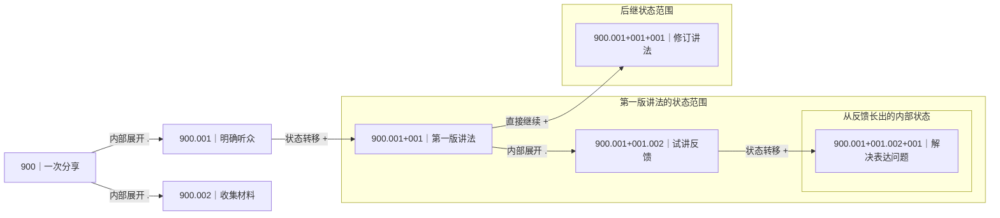

# Mermaid 图：把笔记地址变成项目的发展脉络

在大千里，一张 Mermaid 图可以用来记录一个项目：从什么问题开始，拆出了哪些工作，经过什么尝试，又形成了什么新判断。笔记保存具体内容，图把这些笔记之间的层级与发展关系呈现出来。

第一次使用，先掌握三件事：**A．找到图的入口；B．读懂地址怎样构图；C．随着项目推进继续写笔记。**

## A．一张图放在哪里，怎样打开？

### 从关键词进入一个具体问题

我通常把一个值得持续展开的问题放在 Keyword Index 的一个抽屉中，再用一张 Mermaid 图记录它的实施过程。这样可以沿着“关键词 → 抽屉 → 图的起点笔记 → 具体记录”进入项目。

这里的关键词是进入内容的入口，抽屉帮助组织问题，ATOM 地址表达笔记的位置与关系。这是一种推荐的组织方式；并不是每个抽屉都会自动生成一张图，也不要求所有笔记都必须放进图里。

![[Pasted image 20261028155422.png]]

*上图是使用场景：在一个主题下面，把不同问题组织成独立入口，需要展开实施过程时再进入对应的图。*

### 先分清两个属性

| 属性 | 用途 | 设置位置 |
| --- | --- | --- |
| `mermaid图之起始: true` | 把这篇笔记标记为一张图的起点，供 EVA 索引及相关树视图识别 | 起点笔记 |
| `所属块` | 告诉 Mermaid 浮动图：从当前笔记打开时，应该显示哪张图 | 从中打开图的笔记；通常指向同一张图的起点 |

**只有“起始”标记还不够。当前浮动图会读取当前笔记的“所属块”，沿链接找到起点，再从起点编号收集相关节点。**

假设准备练习一个新主题，起点文件叫 `ATOM@900- 一次分享.md`。先确认 `900` 在自己的库中尚未使用，再在笔记属性里设置：

```yaml
mermaid图之起始: true
所属块: "[[ATOM@900- 一次分享]]"
```

起点的“所属块”可以指向自己。它下面的记录，例如 `ATOM@900.001- 明确听众.md`，也把“所属块”指向这篇起点笔记。已有属性保留，只添加或修改需要的字段；用源码编辑时，把字段放进笔记顶部已有的 YAML 属性区，不要另建第二个属性区。

然后：

1. 打开这张图的起点或其中一篇已设置“所属块”的笔记。
2. 按 `Ctrl+P` 打开命令面板，搜索 `Toggle Mermaid floating widget`，运行 **Mermaid Floating Widget** 的对应命令。
3. 等待图显示。再次运行同一命令会关闭已打开的浮动图；需要重新打开时再运行一次。

这里由插件根据笔记生成 Mermaid 图，入门时不需要手写整张图的 Mermaid 代码。下面所有 `900` 地址都是讲解示例，本文没有替你创建这些笔记。

## B．地址怎样变成节点、连线和嵌套框？

### 1．先把“地址”和“标题”分开

一个规范的文件名可以写成：

```text
ATOM@900.001+001.002- 补充听众反馈.md
└────── 地址 ──────┘  └── 标题 ──┘
```

`ATOM@` 后、`- ` 前是地址，后面是给人看的标题。文件名中的 **半角短横线后保留一个空格**，以便插件按预期拆出地址和标题。

图里的一个实际笔记节点对应一篇笔记。地址负责说明“它从哪里长出来、与谁有关”，标题说明“它写的是什么”。同一编号不要分配给两篇不同笔记；标题不同也不能消除地址重复。

### 2．点号 `.`：向一个节点内部展开

假设已有 `ATOM@900`，继续增加以下笔记：

```text
ATOM@900             一次分享
├─ ATOM@900.001      明确听众
│  └─ ATOM@900.001.001  整理听众的三个问题
└─ ATOM@900.002      收集材料
```

- `900.001` 与 `900.002` 都是在 `900` 内部展开的内容，是同层的两个分支。
- `900.001.001` 是在 `900.001` 内部继续细分。
- `001`、`002` 用于区分地址；**它们相邻，不代表“明确听众做完后，自动进入收集材料”**。

因此，`.` 回答的是：**“这个节点里面，还有什么？”**

### 3．加号 `+`：从一个节点发展到新的状态

如果“明确听众”之后，你有了新的方案，可以这样记录：

```text
ATOM@900.001                 明确听众
    → ATOM@900.001+001       形成第一版讲法
        → ATOM@900.001+001+001  根据试讲修订讲法
```

每次在现有地址后追加一个 `+编号`，表达从这个节点继续发展，形成新的状态或后续记录。插件会据此建立状态转移关系。

因此，`+` 回答的是：**“从这里出发，后来发展成了什么？”** 它不是“完成”按钮，也不会自动推进项目；需要你创建对应笔记、记录变化。

特别注意，下面两种写法含义不同：

| 写法 | 关系 |
| --- | --- |
| `900.001+001` 与 `900.001+002` | 都从 `900.001` 出发，是两个并列后继；不会仅因编号大小自动连成先后顺序 |
| `900.001+001` 与 `900.001+001+001` | 后者从前者出发，明确表达连续发展 |

### 4．`.` 与 `+` 交替：在一个状态里展开，又从内部继续发展

读长地址时，不要只数点号或加号。**从左往右，每次看“在已有地址后追加了什么”。**

以 `ATOM@900.001+001.002+001` 为例：

| 读到这里 | 怎样理解 |
| --- | --- |
| `900` | 一次分享的起点 |
| `900.001` | 进入内部的“明确听众”分支 |
| `900.001+001` | 从“明确听众”发展出“第一版讲法” |
| `900.001+001.002` | 在“第一版讲法”里面展开“试讲反馈” |
| `900.001+001.002+001` | 从这条“试讲反馈”继续发展出“解决表达问题” |

这里有两个容易混淆的情况：

- `900.001+001+001`：直接从“第一版讲法”这个状态继续，形成后继状态。
- `900.001+001.002+001`：先进入“第一版讲法”的内部成员，再从成员长出新的状态分支。

**前者是状态之间的延续，后者会形成内部的嵌套发展。** 加号更多，不等于图框一定嵌得更深；关键是新状态从头领本身出发，还是从它的内部成员出发。

### 5．为什么图里会出现 `subgraph` 大框？

插件把以 `+编号` 结尾的状态节点识别为“头领”，再将头领及其内部展开组织为 Mermaid 的 `subgraph`，也就是图中的一组框。

- **节点**：一篇具体笔记，可以承载正文与记录。
- **头领**：一个状态的起点，本身仍然是一篇笔记。
- **子图框**：包住这一状态及其内部脉络的容器，不是额外的一篇笔记。

例如，`900.001+001` 是头领；`900.001+001.002` 是它的内部成员；成员发展出的 `900.001+001.002+001` 又形成内部状态框。头领直接延续出的 `900.001+001+001` 则是同一外层范围里的后继状态，不应只因地址更长就把它理解成内部成员。

下面是关系示意，重点看包含关系与箭头含义；实际浮动图的颜色、间距和走线由插件布局决定。



### 6．插件把地址变成图，大致经过哪些步骤？

1. **确定范围**：读取当前笔记的“所属块”，找到图的起点编号。
2. **收集笔记**：按这个编号前缀取得候选笔记，再按地址关系组织相关节点。
3. **拆出身份**：从文件名解析地址和标题。
4. **识别关系**：区分点号展开、加号状态转移，以及头领所属的容器。
5. **组织子图**：把状态头领、内部成员和内部状态放进相应层次的框。
6. **生成并布局**：生成 Mermaid 文本，绘出节点、连线与嵌套框。

这说明：**只把文件放在同一个文件夹，或只填写“上级条目”，并不足以替代 Mermaid 的地址关系。** “所属块”选择看哪张图，地址决定图内部如何展开，起始标记说明哪里是图的入口，三者各有用途。

实际图中还可能叠加笔记引用线或用于安排位置的辅助线。不要把所有箭头都理解成任务依赖，也不要只看左右位置判断先后；先读地址，再看线表达的关系。

## C．怎样用它持续记录一个项目？

每次新增记录前，先判断自己正在做哪一种事：

- **补充当前问题的内容**：在相应节点下用 `.` 展开，例如补材料、拆问题、记录一个观察。
- **记录新的判断或阶段变化**：从对应节点用 `+` 延续，例如试验后形成新方案、失败后转向另一个办法。
- **在新状态中继续工作**：先用 `+` 建立状态，再用 `.` 展开其中的材料与处理过程；内部出现新发展时，再从那个成员接 `+`。

正文写清楚当时的问题、依据、尝试与结果。后续有了新认识，可以新增延续笔记，让原来的判断仍然可回看。这样，图既能展示项目的宏观结构，也能保留“为什么走到这一步”的过程。

![[1e051508f30f21cbc11f322831756eb7.png]]

*上图展示的是一个实际项目的展开：状态框中包含具体记录，记录又长出新的状态。先看头领和框的范围，再进入相关笔记阅读细节，不必一次读完所有节点。*

### 打不开或关系不对时，先检查这些地方

| 现象 | 优先检查 |
| --- | --- |
| 提示缺少“所属块” | 当前正在打开的笔记是否有这个属性，链接是否指向实际存在的起点笔记 |
| 起点找不到、标题识别异常 | 文件名是否遵循 `ATOM@地址- 标题.md`，尤其是 `- ` 后的空格 |
| 节点没有进入预期的图 | “所属块”是否选对图；地址是否接在正确的起点编号下；相关索引是否已经更新 |
| 以为串行的两个状态却并列出现 | 是否写成了同一个来源的 `+001`、`+002`，而不是在前一个状态完整地址后继续追加 `+编号` |
| 层次或定位混乱 | 是否有重复地址、缺少中间笔记，或把内部展开与状态延续混用了 |

新增笔记后可稍等索引更新，再关闭并重新打开浮动图。命令面板找不到入口时，先在社区插件中确认 Mermaid Floating Widget 已启用。

---

返回：[[Examples/ATOM@002.002- 分类：具体库当中的插件的应用、说明和例子|组件使用说明目录]]。

还可以结合 [[System/Mermaid/ATOM-List|ATOM 演示入口]] 查找库中的示例笔记；打开浮动图前，仍需检查当前笔记的“所属块”设置。
