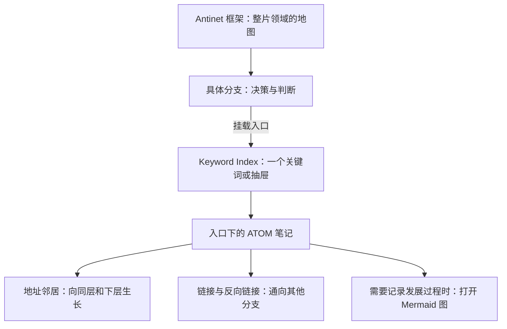

# 树和关键词：让每次落笔都有上下文

笔记有了编号，彼此能够链接，也给关键位置设置了关键词，为什么仍然会觉得“找得到某个点，却掌握不了整个库”？

这是我使用过程中遇到的问题。关键词很擅长唤起一个已知概念，却不一定能告诉我：这个概念周围还有哪些方向，它属于哪片更大的领域，有没有另一个分支已经在处理类似的问题？我需要把整体结构真正画出来，再把关键词挂到相应位置上。

![[Pasted image 20261028213945.png]]

*图中是 SuperMemo Concept Display 的“Antinet 框架”：大框架逐层展开，关键词挂在具体节点下，右侧用于查看节点路径、说明和已挂载入口。这是结构形式示例，你自己的库可以从很小的一棵树开始，不必照抄图中的领域。*

## A．四种组织方式怎样互相补足？

在这套库的使用方法里，我把四个部分配合起来理解：

| 部分 | 回答什么问题？ | 日常作用 |
| --- | --- | --- |
| 地址编码 | 这篇笔记在什么位置，与邻近笔记怎样接续？ | 用 ATOM 地址持续插入、细分和发展 |
| 笔记链接与反向链接 | 除了邻近位置，还有哪些内容与它有关？ | 连接不同分支，保留论证、引用与来路 |
| 关键词 | 我想到这个概念时，从哪里进入？ | 作为通往笔记网络的明确入口 |
| 可视化框架树 | 整个库有哪些区域，这个概念处在什么上下文中？ | 看全局、找邻居、发现空白与重复建设 |

地址让内容有位置，链接让不同位置互通，关键词帮助唤起入口，框架树让入口之间的整体关系可见。它们共同工作，才能兼顾“进入一个点”和“看见它所在的区域”。

这里讲的是我的组织与使用模型，不要求每篇笔记都同时挂满关键词、链接和框架节点。开始时先把最常用的入口连起来即可。

## B．先分清：这里说的“树”是哪一棵？

上一篇两侧的树和列表，主要是对 **ATOM 笔记地址** 的导航。这一篇的 **Antinet 框架树**，则是你主动搭建的领域地图。两者通过关键词入口相连，各自表达不同内容。

| 界面 | 组织的对象 | 它的层级从哪里来？ |
| --- | --- | --- |
| EVA 分支树、ATOM 侧栏导航 | 实际 Markdown 笔记 | 主要来自笔记地址和相关索引规则 |
| SuperMemo 的 Antinet 框架 | 领域、问题分支，以及挂载的 Keyword Index 入口 | 手动框架节点的父子关系；挂载来源下还可显示 Keyword 的抽屉层级 |
| SuperMemo 的主体结构树 | SuperMemo Concept 对象的整体组织 | 独立的主体结构节点与 Concept 归属 |
| Mermaid 浮动图 | 某个起点范围内的笔记发展过程 | 地址中的 `.`、`+` 与状态容器关系 |

**这篇要使用的是“Antinet 框架”标签页。** 不要因为它与“主体结构树”都画成树形，就把两者当作同一个功能。

在 Antinet 框架里新建一个叫“决策与判断”的节点，并不等于已经新建一篇同名 Markdown 笔记；移动框架节点，也不等于批量修改笔记地址。框架上显示的 `001-`、`002-` 等名称编号可以帮助阅读与排序，实际父子关系由添加子节点或移动操作建立。

可以把整条路线这样理解：

这是一张使用路线示意图，不表示框架、关键词和笔记会被复制成三份。框架节点保存组织意图，Keyword Index 保存关键词入口，Markdown 笔记承载正文；挂载关系由 EVA 连接。

## C．为什么只有关键词还不够？

### 关键词帮助想起已知内容，树还可以容纳尚未理解的区域

假设我已经记得“复盘”这个词，直接找关键词很有效。但如果我只是感到“如何从经验中改进判断”值得探索，还说不出成熟概念，这时只找关键词就容易受已有词汇限制。

框架树可以先保留一条“经验、判断与修正”的分支，写清它在问什么。它暂时没有挂载关键词，也有用：它让未知方向保持可见，给以后遇到的材料一个可能的落点。

一个分支可以容纳多个不同关键词，因此不必强行找一个词代表整片领域。随着材料增加，还可能发现几个分支共享的问题，进而补出更上层的组织关系。树不仅支持向下细分，也帮助我回头调整上层理解。

### 先看位置，减少在 A、B 两处重复开辟同一片内容

没有整体地图时，我可能今天在 A 处写一个概念，过一段时间又从另一个关键词出发，在 B 处重新建立一套相似内容。两处各自看都合理，放到整个库里却难以照应。

有了框架树，每次新增前就能先看候选分支、相邻分支和已有入口：已有内容足够接住新想法时，继续生长；确实是另一种问题时，再建立新分支，并用链接说明两者关系。

这能减少无意的重复，却不保证自动得到唯一、永远最优的分类。树是当前理解的表达，可以修订；不同视角确实需要并存时，也不必为了只剩一条路线而强行合并。

## D．在插件里建立第一条可用路线

### 1．打开 Antinet 框架

按 `Ctrl+P`，搜索 **Open SuperMemo Concept Display**，打开后选择 **Antinet 框架**。

先浏览已有结构。如果目前为空，从自己最常写的一个领域开始，不必先设计全库。比如建立“学习与表达”，再在里面加入“面向他人的讲解”。这是示例名称，不要求与某个 ATOM 编号一一对应。

### 2．添加节点，写清这片区域的边界

使用顶部 **添加框架节点** 创建顶层节点；选中节点后，使用右侧的添加子节点按钮继续展开。右侧 **添加说明** 可以写：

> 这里回答什么问题？通常收什么内容？什么内容应放在旁边的分支？

例如“面向他人的讲解”可以说明：收听众分析、讲法设计和试讲反馈；原始资料整理仍放在相应资料分支，用链接关联。

这样的说明比单独一个宽泛标题更能帮助下次落笔。名称与说明表达领域边界，具体经历、证据和思考仍写进笔记。

### 3．把已有关键词挂到节点上

选中一个手动框架节点，点击 **挂载关键词**。界面会以这个节点作为 A，提示到 **Keyword Index** 选择关键词或抽屉 B；按 EVA Meta 的提示完成选择与关系确认，再回到树上查看“已挂载关键词”。

如果还没有合适的关键词，可以先保留这个框架节点，之后在 Keyword Index 建立入口并组织相关笔记，再回来挂载。不需要为了让树“看起来填满”而创建空洞的关键词。

挂载的作用是把结构位置与已有入口连接起来，不是搬运笔记。挂载来源下显示的自动抽屉跟随 Keyword Index 的名称与层级；手动框架节点则表达你自己补充的组织结构。需要修改来源抽屉时，回到 Keyword Index 操作。

### 4．分清“在树里定位”和“打开来源”

已挂载入口可以有一个适合当前位置的本地义名。它描述“这个入口在这里意味着什么”，不改变 Keyword Index 中的原名。

普通挂载条目与 **义胶囊** 可以相互定位，方便从熟悉的概念回到框架位置。真正进入来源时，使用已挂载关键词旁的跳转按钮，选择：

- **打开 Keyword Index**：查看这个关键词或抽屉的上下文，再选具体条目。
- **直接打开 Note**：进入关联笔记；如果对应多篇，会出现选择列表，需要自己选定目标。

第一次摸索时，先打开 Keyword Index 更容易了解入口包含什么；已经熟悉具体材料时，可以直接打开 Note。

## E．带着一个新想法走一遍

假设刚做完一次分享，想到“讲得完整不等于听众听得懂”：

1. **看树找领域**：先去“学习与表达 → 面向他人的讲解”，读一眼节点说明和相邻分支。
2. **沿关键词进入**：查看已有的“听众理解”或相关入口，确认过去是否已讨论过类似问题。
3. **读地址附近的笔记**：看看它是在同一问题上补充证据，还是提出了一个更细的问题。
4. **新增并写正文**：按上一篇选择智能编号或子级编号，把这次观察、依据和判断写下来。若属于 Mermaid 中的状态发展，则按第一篇的地址关系另行组织。
5. **补必要的连接**：用笔记链接关联另一分支的材料；需要新的关键词入口时，在 Keyword Index 建立，再挂到框架的合适位置。
6. **回看地图**：几次积累之后，检查原来的节点说明是否仍然合适，有没有值得新建或调整的分支。

也可以反过来：先想起一个义胶囊，从它定位回树，看看周围还有哪些关键词，再进入笔记网络。**从树找入口，从入口回到树，两条路线互相补充。**

对我来说，最有帮助的体验是：新概念出现时，先找到它适合生长的位置，然后直接在那里写下去。这样更容易让每次落笔带着上下文，减少“先随便存放，以后再整理”的负担。

## 从小树开始，而不是先画一个完美体系

先做好一条“框架节点 → 关键词 → 笔记”的真实路线，就已经可以使用。以后随着写作与回看，逐渐补充邻近分支、节点说明和交叉链接。

一棵有价值的树既能指向已有内容，也能保留尚待探索的位置。判断它是否好用，可以看：下次出现一个新想法时，能否更快找到合适的上下文；过一段时间回来时，能否理解当初为什么把内容放在这里。

上一篇：[[ATOM@002.002.002- 其次是新增笔记，笔记地址的排列规则，新增笔记插件和两侧的视图|新增笔记、地址规则与两侧视图]]。

相关：[[ATOM@002.002.001- 首先是mermaid图的使用方法|Mermaid 图：记录局部的发展过程]]。
