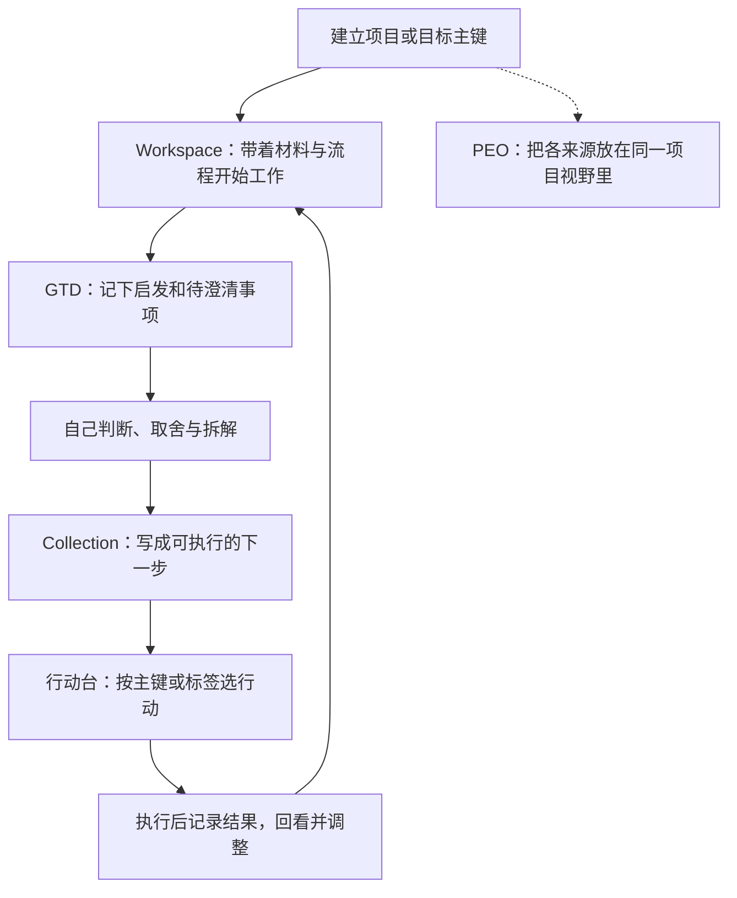

# 项目与目标：用主键把工作环境、思考和下一步行动连起来

前面几篇介绍了知识怎样进入笔记网络。这一篇进入日常执行：有了一个想推进的项目，怎样建立它、积累过程材料、找到下一步，并在一段时间后回看？

在这套系统里，工作主要围绕**操作上下文主键**展开。主键代表你正在管理的一个项目或目标，把相关界面连接起来；每个界面各司其职，帮助你从不同角度进入同一件事。

你不需要一开始就填满所有页面。先建立一个主键，放进必要的材料，写出一条可以开始做的行动，就能走通第一轮。

## A．主键是什么，项目和目标怎样选？

### 主键是共同的工作对象

例如“准备一次十分钟分享”，可以有听众资料、讲稿、试讲记录、待办、日程和每周复盘。这些内容分散在不同界面里，但都围绕同一个项目主键组织。

主键回答的是：**“现在这些内容，是在为哪件事服务？”** 它帮助界面认出同一个对象，而不是要求把全部内容塞进一篇笔记。

| 容易混淆的东西 | 与这里的主键有什么不同？ |
| --- | --- |
| ATOM 笔记地址 | 说明笔记在知识网络中的位置；项目主键连接的是多个工作界面中的同一管理对象 |
| Keyword Index 的关键词 | 是进入知识内容的符号入口；可以与项目有关，但不等于项目身份 |
| 行动台的标签 | 用于跨项目挑选待办，例如“沟通事项”“需要整理”；一条行动可以有多个标签 |
| Workspace 或 Collection 的某个 Tab | 是具体内容的容器；主键通过绑定关联它，不等于 Tab 本身 |

编号与名称方便人阅读，但同名、同号并不自动证明是同一个对象。尤其是旧项目结束以后又使用类似编号时，要从正确的管理入口创建、核对来源，不能仅凭文字相同就把两份记录当作一份。

### 项目与目标：先按自己的推进方式选择

- **项目**：适合围绕一件具体工作组织材料和行动，例如“完成一份报告”“准备一次分享”。当前项目入口以 Workspace 的项目载体为基础。
- **目标**：适合从九宫格中选定一个希望推进的方向，例如“改善表达能力”。系统中的目标主键以九宫格节点为基础，还需要相应的承载与追踪关联。

这是入门时的选法，不是严格的项目管理分类标准。一个长期方向可以启发多个具体项目；系统不会因为两者名称接近，就自动建立从属关系。也不必为同一件事同时创建一份项目和一份目标。

### 先认识总览的样子

![[Pasted image 20261028215716.png]]

*这是 PEO（项目执行总览）的一个较小示例。上方选择工作入口，中间选择分组，下方把同一组的不同来源并排展开。它帮助你了解项目环境；真正编辑内容时，再进入相应来源。*

这张图可以分三层读：

1. **上方 Keywords 入口**：显示来自不同视图的主键入口，旁边的 Workspace、九宫格等标记说明来源。这里的 Keywords 不要直接等同于上一章的 Keyword Index 知识关键词。
2. **中间分组导航**：在当前 Workspace 或九宫格视图中选择一个工作分组。分组导航与顶部入口的用途、范围不同，数量不必相同。
3. **下方来源列**：并排查看 Workspace、九宫格、Keyword、范式积累、GTD、Collection Card、Timeline。通过条目上的入口查看关系、评论或跳回来源。

图中的“关系”和连线数量表达结构联系，不等于“前一项做完，后一项自动开始”。这一页也不是把各列内容搬到 PEO 里重存一遍。

## B．怎样启动自己的第一个项目？

### 先把本轮要用的页面加载出来

![[Pasted image 20261028214909.png]]

*视图组把常用入口放在一起，便于在项目环境、执行过程和回顾规划之间切换。*

> **本库当前的启动使用经验：** 打开库后，打开“视图组”，把 **GTD 待办事项 → Workspace Mount → Collection Card → 项目执行总览（PEO）** 依次点开一遍，并等待各页内容出现，再开始管理主键或使用下一步行动台。仅展开视图组菜单，不等于这些内容页面都已初始化。

这是当前这版库的使用步骤，不是在设置里反复关闭、启用插件。若某页仍提示“追踪待核验”或“查询未完成”，先看相关页面是否已加载，再按提示重新核验或刷新。暂时空白、加载失败与“没有数据”是不同状态；持续不恢复时保留报错信息，不要用反复新增同一项目来解决。

### 从主键管理中心创建

按 `Ctrl+P` 搜索 **打开主键管理中心**，或点击工具栏上的主键管理中心入口。

![[ABC-004-主键管理中心.png]]

*顶部“新增项目”“新增九宫格目标”是建立自己工作对象的入口；已有条目右侧的“管理追踪”“名称与同步”分别负责追踪和名称管理。截图中的“目标查询未完成”是当时的核验提示，并不表示目标数量为零；实际操作前应先恢复相关来源的正常加载。*

1. **选择类型**：具体项目点“新增项目”；从九宫格组织的目标点“新增九宫格目标”。
2. **填写并核对信息**：按弹窗填写名称、主键编号等必填项，并核对来源；创建目标时，还要核对其所在位置等目标信息。
3. **预览创建范围**：先点“预览创建范围”，确认准备创建的是自己想要的项目或目标，以及正确的关联来源。预览本身尚未创建业务内容。
4. **确认创建并同步**：确认范围后提交，等待结果。这个操作会协调相关插件建立载体和关联，不是只给列表加一行文字。
5. **查看结果**：创建完成后，在中心核对对象，再去 PEO、Workspace 或九宫格查看来源，最后在下一步行动台找到对应主键。

如果显示“已确认但尚未完成”，从 **未完成的创建** 找到这次任务，查看进度，并使用界面提供的继续／核验操作。若显示“已创建、尚未交由中心维护名称”，按提示 **继续登记／接管**。这些状态不等于“完全没创建”，应沿原任务恢复，避免另建一份同名对象。

### 项目改名与停止追踪，也从中心进入

| 想做什么 | 操作入口与含义 |
| --- | --- |
| 修改主键正式名称 | 在该对象旁点 **名称与同步**。已由中心维护的对象，修改“主键新名称”，保留原编号，点“预览改名范围”核对，再“确认保存名称”；如出现 **继续同步**，继续完成各插件更新 |
| 老对象尚由原入口管名 | 按“名称与同步”面板提示先核对身份、登记或接管，再执行改名；不要在多个插件里分别手改同一个主键来凑一致 |
| 暂停推进这个项目或目标 | 点该对象的 **管理追踪**，在管理面板中核对对象，再执行停止追踪 |
| 以后重新推进 | 在目录范围中查看项目／目标追踪记录（含已停止），找到原对象，进入 **管理追踪** 恢复；仍需通过当前来源核验 |

**停止追踪不是删除内容。** 它让对象退出当前推进范围，保留已有材料与历史；恢复时回到原对象继续，不需要重新建一个同名项目。

中心改的是主键名称及其同步映射，不保证每张卡片标题、每个 GTD 标签标题都随之变成同样的字。行动台中的“修改行动台名称”又是该界面的本地显示名，也不要把它当作全系统正式改名。

## C．同一个主键下，分别在哪里做什么？

这套设计把“项目是什么”“我掌握了什么”“可能要做什么”“现在能做什么”“什么时候做”分开放置，再用主键连起来。

| 界面或部分 | 主要用途 | 以“准备一次分享”为例 |
| --- | --- | --- |
| **PEO／项目执行总览** | 汇集同一工作对象的来源信息、查看关系、跳回原处 | 一眼查看资料、目标、待办和安排分布在哪里 |
| **Workspace Mount** | 工作环境、流程范式的应用、过程材料与记录 | 按已有分享流程推进，记录本次做了哪些调整 |
| **九宫格与执行计划** | 目标方向、上层项目理解与阶段推进 | 说明希望达到什么效果、当前现实与关键里程碑 |
| **Keyword／范式积累** | 知识入口，以及事实、经验、方法和过程证据 | 链接过去的表达经验，保留试讲反馈与调查资料 |
| **GTD** | 工作过程中出现的启发与尚待打磨的事项 | “是不是需要先了解听众的问题？” |
| **Collection Card** | 承载更明确的下一步待办 | “列出三位听众最关心的问题，写进准备笔记” |
| **下一步行动台** | 围绕主键查看和执行 Collection 待办，用标签跨项目筛选 | 选定本项目，找到今天能开始的一条行动 |
| **Timeline、时间记录与周追踪** | 分别处理时间安排、实际投入、阶段回看 | 给试讲安排时段，记录投入，周末判断接下来怎么调整 |

我通常在 Workspace 中应用已经保存的流程范式，并记录这一次怎样使用它、哪里需要调整。GTD 接住过程中出现的启发；这些事项经过判断和拆解后，再成为 Collection 中更具体的下一步。

这是一种工作习惯，不是系统会自动运行的搬运流水线。不是每条 GTD 都必须变成任务，也不是每个项目都必须填满七列；当下一步已经很明确时，可以直接在行动台新增。

*箭头表示推荐的使用过程，不表示插件自动转换或自动完成任务。*

### 怎样把一个念头写成下一步？

“研究一下分享怎么准备”仍然需要再次思考才能动手；“打开上次讲稿，列出三处听众听不懂的位置”已经给出了对象、动作与一个可判断的结束点。

| 当前写法 | 再澄清一步 |
| --- | --- |
| 要不要联系对方？ | 先确定要问什么、联系谁；决定行动后，写成“给某人发送三个确认问题” |
| 整理资料 | 写成“把这次试讲的反馈整理成三条修改意见，放进准备笔记” |
| 完成整个报告 | 拆出“根据已有材料列出报告目录”，后续再继续细化 |

Collection 是下一步行动的承载处，但软件不会自动判断每条文字是否已经足够清晰。若条目仍是一个疑问或方向，先澄清它，或打开“行动结构”进一步整理，再决定执行哪一步。

## D．复杂项目里，PEO 为什么有用？

![[ABC-004-复杂项目总览.png]]

*这是一个“新增项、能力建设”的复杂项目实例。它展示的是项目环境与已有记录的分布，不是要求初学者一开始就做到同样的规模，也不是一份今天全部要执行的清单。*

可以从左到右阅读，同时随时回到具体来源：

- **Workspace**：项目的工作锚点，说明当前围绕哪件事展开。
- **九宫格**：与项目相连的目标或方向，让行动有上层背景。
- **Keyword**：相关知识、经验的入口，例如既有研究和能力建设线索。
- **范式积累**：文件位置、调查方法、工作流程、历史处理记录。这些是判断与行动的依据，本身不都属于待办。
- **GTD**：尚在考虑、需要澄清或决定的事情，例如某类资料是否还需要进一步了解。
- **Collection Card**：已经收集的下一步事项。读到仍然模糊的条目时，可以继续拆解，不必把“已经放进这一列”当成行动质量合格。
- **Timeline**：日程、计划和里程碑所提供的时间背景。截图中也有历史日期，不应直接理解为今天仍须执行的安排。

各列的数字、右上方的条目数和连线数，说明当前展示的数量，**不表示项目完成百分比，也不表示全部工作已经被记录**。某列为空，也可能只是没有挂入该组的来源内容；若同时出现加载或核验错误，应先处理读取问题再判断。

PEO 的价值是把“我要做的事”放回“为什么要做、已有些什么、此前怎样推进”的环境里。想了解项目全貌时先看 PEO；已经准备开始干活时，再去下一步行动台。

## E．下一步行动台：先看主键，再看执行条件

从视图组点 **下一步行动台**，或使用命令 **打开下一步行动台（Collection）**。本文截图对应的是这个 Collection 行动视图；另一个不带“Collection”的同名旧入口可能打开不同界面。

### 按主键：今天要推进哪个项目？

![[ABC-004-行动台项目待办.png]]

顶部的 **项目主键／目标主键** 区分对象类型。选择主键后，右侧列出它的待办及完成记录。这样你不必先翻完整个项目材料，就可以回到明确的执行入口；需要上下文时再返回来源或去 PEO。

在对应主键下面，可以：

1. 使用 **新增下一步待办**（有的截图显示为“新增下一步行动”）写下准备执行的事项，核对写入位置后保存。
2. 用勾选按钮标记完成；完成的记录进入“已完成”区域，必要时可以撤销完成。
3. 用标签按钮添加适合自己的执行标签；用 **打开行动结构** 继续拆解或补充行动说明。
4. 用 **返回来源** 找回对应条目。在项目／目标页，它打开 Collection 来源；在标签筛选页，它先返回行动台对应主键并定位同一条行动。

### 按标签：眼下适合处理哪一类事情？

![[ABC-004-行动台标签筛选.png]]

主键回答“为哪件事工作”，标签回答“这条行动适合怎样处理”。例如：

- **沟通事项**：集中处理需要联系、确认的行动。
- **需要整理的内容**：安排一段整理时间时，跨项目查找同类事项。
- **着急工作／重点工作**：提醒自己优先关注的内容。
- **破冰界王拳**：截图中的个人化标签。具体含义由使用者约定，也可以换成你自己理解和愿意使用的名字。

这些标签是使用者的管理约定，不是系统内置的自动优先级规则。给行动加标签，不会把它从原主键搬走，也不等于给知识笔记建立 Keyword Index 入口。

进入 **标签筛选** 后，有三种匹配方式：

| 模式 | 显示什么？ | 示例 |
| --- | --- | --- |
| 单个标签 | 带有当前选中标签的行动 | 只看“沟通事项” |
| 任一包含 | 所选标签满足任意一个即可，是并集 | “沟通事项”或“着急工作” |
| 全部包含 | 同一条行动必须具备所有选中标签，是交集 | 同时是“沟通事项”并且“着急工作” |

筛选结果仍按主键分组，因此你能把跨项目的同类行动放在一起处理，又不丢失它们各自的项目背景。“所在主键”还可以进一步缩小范围；想回到更宽的范围时，清除已选标签或调整该筛选。

不要一开始设计很多标签。先选两三种真正影响行动选择的分类，用一段时间再调整。截图中已有的标签名称、数量和完成记录只是实例，并不是新库必须照搬的清单。

### Collection 和行动台怎样分工？

可以把 Collection 理解为下一步待办的内容承载处，行动台则给它增加执行管理的视角。当前这一界面由 Collection 提供，下一步行动台插件在后台保存完成状态、标签、显示别名、行动台名称和行动结构等信息。

因此，这套工作依赖两者配合。只复制 Collection 内容，不等于同时带走全部行动台管理记录；只改行动台显示名，也不等于修改了主键正式名称或来源条目标题。

## F．“有效操作上下文主键”中的“有效”是什么意思？

“有效”不是说这个项目有价值、已经完成，或数据在磁盘上存在；它表示**系统当前能确认这个对象具备继续进入工作界面的条件**。

大体上，需要确认来源载体还在、主键声明明确且唯一、追踪关系存在并且没有停止。项目侧以 Workspace 项目载体为基础；目标侧以九宫格节点为基础，还要有通往 GTD 顶层项目的明确、唯一承载关系。仅有一个同名标签或九宫格节点，不足以完成这些关联。

这些条件由相关插件共同核验。日常使用尽量通过主键管理中心创建、改名和管理追踪，不需要自己手写底层声明或复制内部编号。

| 看到的状态 | 应怎样理解与处理？ |
| --- | --- |
| 当前有效 | 当前来源与追踪条件已得到核验，可以进入相应的前向工作流程 |
| 已停止追踪 | 明确退出当前推进范围；去追踪记录或历史入口回看，想继续时恢复原对象 |
| 追踪待核验／查询未完成 | 还不能判断当前状态；可能涉及加载、来源或同步问题，不等于已停止或内容被删除 |
| 已确认但尚未完成创建 | 这次创建已有记录；查看原任务进度并继续处理，不另建同名对象代替 |

历史材料、旧周记录和过去的 Timeline 安排仍有保留价值，但它们不会单独把一个已退出的对象重新变成“当前有效”。

## G．一轮工作怎样收束，再开始下一轮？

第一次练习，可以只走这条短路线：

**加载四个来源页面 → 主键管理中心新增项目 → Workspace 放入必要材料 → 行动台写一条明确待办 → 执行并标记完成 → 回到项目记录结果。**

项目逐渐复杂以后，再加入周追踪与时间规划：

- **项目执行计划／项目纵向管理**保留愿景、价值、当前现实、下一步和里程碑等上层理解。
- **按周汇总／周追踪**记录某一周实际怎样推进、有什么判断、下一周怎样接手；它不是整个项目的唯一现状。
- **Timeline**安排具体时间与里程碑；**时间框架**帮助安排更大的阶段与成果结构。

这套设计希望保留两种视野：看项目时，能找回过程与依据；准备执行时，能迅速找到下一步。工作不再只是一张孤立的待办清单，也不至于只有丰富材料、却不知道从哪里开始。

上一篇：[[ATOM@002.002.003- 树和关键词的结合，库整体结构设计|树和关键词：知识怎样组织起来]]。

相关：[[ATOM@002.002.001- 首先是mermaid图的使用方法|Mermaid 图：怎样记录一个过程的发展]]。
